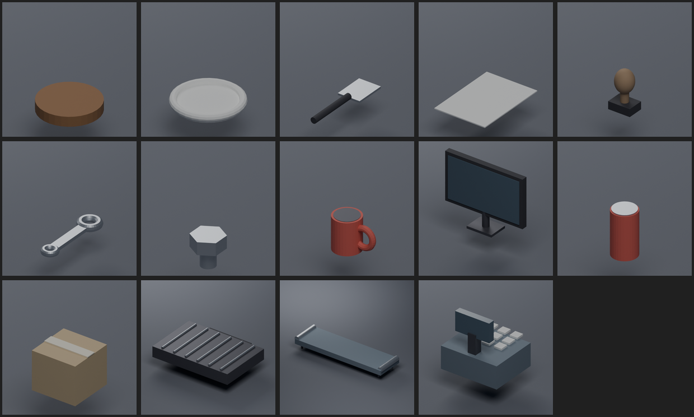

# Job Simulator 2

The sequel to working. Clock in, work a shift, get paid.

Four jobs on the board: grill patties before they burn, stamp paperwork like you mean it, tighten bolts on an engine block, and scan groceries off a conveyor. Work all four shifts to finish the day, then do it again tomorrow for more money.

Built with Godot 4. Low-poly props modeled in Blender.



## Run it

Download a build from [Releases](https://gitlab.com/HttpAnimations/job-simulator-2/-/releases), or open the project in Godot 4.7+ and press play.

## Build from source

You need Godot 4.7 and the matching export templates.

```
godot --headless --import
godot --headless --export-release "Linux" build/linux/job-simulator-2.x86_64
godot --headless --export-release "Windows" build/windows/job-simulator-2.exe
godot --headless --export-release "Web" build/web/index.html
```

## License

AGPL-3.0. See LICENSE.
